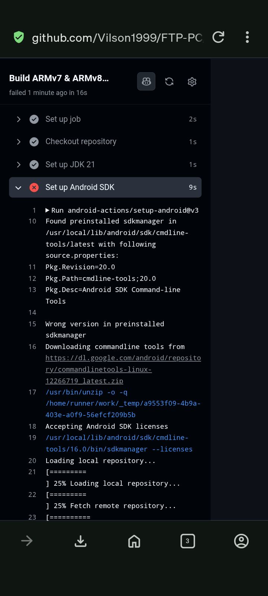
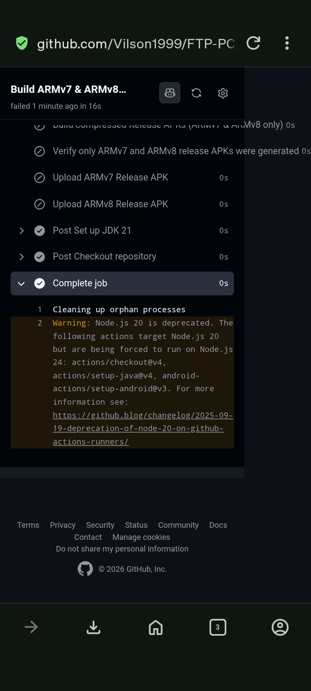

<p align="center">
  
</p>

<p align="center">
  <strong>Share files from your Android phone to a Windows PC over Wi-Fi or a hotspot.</strong><br />
  Start one or more FTP servers, choose which storage each server exposes, and connect from an FTP client on your PC.
</p>

## About

FTP PC is an Android app that turns your phone into a local FTP server for transferring and managing files from a computer. The project description highlights running up to four FTP servers simultaneously.

## Features

| Category | Details |
| --- | --- |
| **File sharing** | Transfer files between your Android device and a PC over the same Wi-Fi network or hotspot. |
| **Multiple servers** | Manage up to four FTP slots; the default ports are **2121–2124**. |
| **Storage** | Choose a storage location for each FTP slot, including available internal or SD-card storage. |
| **Server controls** | Start and stop servers, view their status, and copy an FTP address from the dashboard. |
| **Background** | Optionally keep the FTP server running in the background while it is active. |
| **Settings** | Configure options such as read-only access, anonymous access, hidden files, overwrite behavior, and transfer buffer size. |

## Screenshots

<table>
  <tr>
    <td align="center" width="33.33%">
      
    </td>
    <td align="center" width="33.33%">
      
    </td>
    <td align="center" width="33.33%">
      
    </td>
  </tr>
</table>

## Getting started

1. Install and open **FTP PC** on your Android device.
2. Connect your phone and PC to the same Wi-Fi network, or connect the PC to your phone's hotspot.
3. In the app, choose the storage location for an FTP slot and grant the requested storage access.
4. Tap **Start** and copy the FTP address shown in the app.
5. Open that address using an FTP client on your PC. Use the same network and keep the app's server running during the transfer.

> **Tip:** The default slot ports are 2121, 2122, 2123, and 2124. The address shown in the app is the one to use; network and hotspot configurations can affect whether your PC can reach it.

## Project details

| Category | Details |
| --- | --- |
| **App name** | FTP PC |
| **Developer** | [Vilson Sonkar](https://github.com/Vilson1999) |
| **Platform** | Android |
| **Primary language** | Kotlin |
| **Build scripts** | Kotlin DSL (Gradle) |
| **Minimum Android version** | Android 9 (API 28) |
| **Application ID** | `com.ftppc.vilson` |
| **License** | No license file is currently included in this repository. |

## Build

You will need Android Studio or a compatible JDK and Android SDK. From the repository root, build a debug APK with:

```bash
./gradlew assembleDebug
```

The APK is written to `app/build/outputs/apk/debug/`.

## Repository

[View the source code on GitHub](https://github.com/Vilson1999/FTP-PC)
